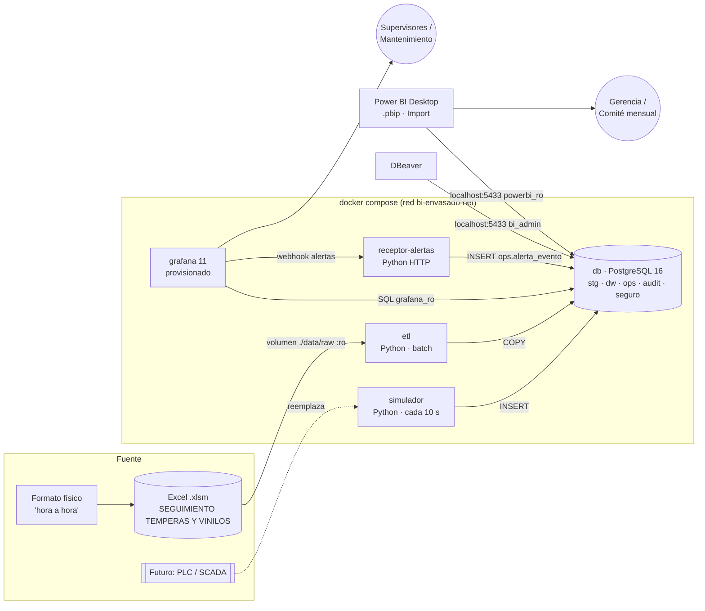

# Solución de BI para el análisis de paros y productividad en líneas de envasado.

**Business Intelligence (ET0194) · Taller 5 / Proyecto final**
Integrantes: **Nicolás Cataño Durango** · **Julián Ramírez Molina**
Repositorio: <https://github.com/TekilaNCD/Solucion-de-BI-para-el-analisis-de-paros-y-productividad>

RECUERDA: para reproducirlo, tiene que copiar el Excel SEGUIMIENTO TEMPERAS Y VINILOS Actividad.xlsm a data/raw/ antes del docker compose up
Solución end-to-end que reemplaza el reporte mensual en Excel del procedimiento **P-MTO-22** por:

- un **modelo dimensional** (constelación de hechos) en **PostgreSQL 16**,
- un **ETL en Python** reproducible, con reglas de calidad y reconciliación contra la fuente,
- un **tablero operativo en Grafana** con datos hora a hora simulados y **alertas**,
- un **tablero analítico en Power BI** (proyecto `.pbip`) conectado a la base de datos,
- todo el lado servidor **contenerizado con Docker Compose** y levantado con **un solo comando**.

---

## 1. Arquitectura



| Capa | Componente | Usuario | Frecuencia |
|---|---|---|---|
| Fuente | Excel `.xlsm` (8.208 filas, 2022-01 → 2025-03) | Mantenimiento | Manual, diaria |
| Integración | ETL Python (`etl/`) | Equipo BI | Bajo demanda / programado |
| Almacenamiento | PostgreSQL 16 (`db/init/`) | — | — |
| Monitoreo | Grafana + alertas (`grafana/`) | Supervisores, mantenimiento | Cada 10 s |
| Análisis | Power BI (`powerbi/`) | Gerencia, coordinador de mantenimiento | Diaria / mensual |

---

## 2. Levantar la solución desde cero (Docker)

**Requisitos:** Docker Desktop (Windows/macOS) o Docker Engine + Compose v2. Nada más.

```bash
# 1. Clonar
git clone https://github.com/TekilaNCD/Solucion-de-BI-para-el-analisis-de-paros-y-productividad.git
cd Solucion-de-BI-para-el-analisis-de-paros-y-productividad

# 2. Credenciales (copiar la plantilla y cambiar las contraseñas)
cp .env.example .env            # Windows PowerShell:  Copy-Item .env.example .env

# 3. Copiar el Excel fuente (no se versiona: contiene nombres de personas)
#    → data/raw/SEGUIMIENTO TEMPERAS Y VINILOS Actividad.xlsm

# 4. Un solo comando
docker compose up -d --build
```

Qué pasa al ejecutar el paso 4 (orden garantizado por `depends_on` + `healthcheck`):

1. **db** crea el volumen `pgdata` y ejecuta `db/init/*.sql` y `09_roles.sh` (esquemas, tablas, índices, vistas, roles de solo lectura).
2. Cuando `pg_isready` responde → **etl** lee el Excel, limpia, carga la bodega, reconcilia y **termina con código 0**.
3. Solo si el ETL terminó bien (`service_completed_successfully`) → arranca el **simulador**.
4. **receptor-alertas** queda escuchando en la red interna; **grafana** arranca con datasource, tablero y alertas **ya provisionados**.

| Servicio | URL / conexión | Usuario |
|---|---|---|
| Grafana | <http://localhost:3000> | `GF_ADMIN_USER` / `GF_ADMIN_PASSWORD` del `.env` |
| PostgreSQL (DBeaver) | `localhost:5433`, base `bi_envasado` | `bi_admin` (dueño) |
| PostgreSQL (Power BI) | `localhost:5433`, base `bi_envasado` | `powerbi_ro` (solo lectura) |

Comandos útiles:

```bash
docker compose ps                       # estado (etl debe aparecer "exited (0)")
docker compose logs -f etl              # ver la ejecución del ETL
docker compose logs -f simulador        # ver los ticks de la simulación
docker compose run --rm etl             # re-ejecutar el ETL (idempotente)
docker compose down                     # apagar conservando datos (volúmenes)
docker compose down -v                  # borrar TODO y volver a empezar desde cero
```

> Si cambian las contraseñas del `.env` después de la primera vez, hay que recrear el volumen (`docker compose down -v`), porque los scripts de `docker-entrypoint-initdb.d` solo corren cuando el volumen está vacío.

### Demo en vivo de la alerta

Desde DBeaver (ver `scripts/demo_falla.sql`):

```sql
UPDATE ops.sim_control SET modo = 'falla' WHERE maquina_codigo = 'Vinilos_3';
```

En ~40 s el OEE móvil de Vinilos_3 cae por debajo del 60 %, la regla **"OEE bajo por máquina"** pasa a *Pending* y luego a *Firing*, Grafana llama al webhook y la alerta aparece en el panel **Bitácora de alertas** (tabla `ops.alerta_evento`). Con `modo = 'normal'` se resuelve sola. `docker compose stop simulador` dispara **"Línea sin señal"**.

---

## 3. Estructura del repositorio

```
├── docker-compose.yml           # orquestación (5 servicios, 2 volúmenes, 1 red)
├── .env.example                 # plantilla de credenciales (el .env real NO se versiona)
├── db/init/                     # DDL que PostgreSQL ejecuta al crear el volumen
│   ├── 01_esquemas.sql          #   stg, dw, ops, audit, seguro
│   ├── 02_dimensiones.sql       #   7 dimensiones (SCD2 en dim_referencia)
│   ├── 03_hechos.sql            #   3 hechos históricos (grano declarado)
│   ├── 04_operativo.sql         #   hecho hora a hora + control del simulador + bitácora de alertas
│   ├── 05_indices_auditoria.sql #   índices justificados + tablas de auditoría del ETL
│   ├── 06_vistas_funciones.sql  #   vistas de KPI (OEE) + función SCD2
│   └── 09_roles.sh              #   roles grafana_ro / powerbi_ro (contraseñas desde .env)
├── etl/                         # imagen Python única (etl, simulador, receptor_alertas)
│   ├── Dockerfile · requirements.txt
│   ├── catalogos/*.csv          # reglas de homologación versionadas (subcódigos, turnos, tipos de paro…)
│   ├── etl/                     # extract → transform → load → reconciliar → reporte
│   ├── simulador/               # generador de lecturas hora a hora
│   └── receptor_alertas/        # webhook que guarda las alertas en la BD
├── grafana/
│   ├── provisioning/            # datasource, proveedor de tableros y alertas (YAML)
│   └── dashboards/operativo_envasado.json
├── powerbi/                     # proyecto Power BI (.pbip/TMDL) + medidas.dax + guía
├── sql/consultas_analiticas.sql # 13 consultas de negocio (ventanas, comparativos)
├── scripts/                     # demo de falla y demo SCD2
├── docs/                        # documentación del proyecto + reportes generados por el ETL
└── data/raw/                    # aquí se copia el Excel (ignorado por Git)
```

---

## 4. Ejecución sin Docker (alternativa)

1. Crear la base `bi_envasado` en un PostgreSQL 16 local y ejecutar en DBeaver `db/init/01…06` en orden (y los `GRANT` de `09_roles.sh` con sus contraseñas).
2. `cd etl && pip install -r requirements.txt`
3. Definir `PGHOST, PGPORT, PGDATABASE, PGUSER, PGPASSWORD` y `FUENTE_EXCEL`, luego `python -m etl`.
4. (Opcional) `python -m simulador` y `python -m receptor_alertas`.

---

## 5. Documentación

| Documento | Contenido |
|---|---|
| [docs/01_negocio_y_fuente.md](docs/01_negocio_y_fuente.md) | Usuarios, preguntas de negocio, diagnóstico de la fuente |
| [docs/02_catalogo_kpis.md](docs/02_catalogo_kpis.md) | Catálogo de indicadores (P-MTO-22 + nuevos) |
| [docs/03_modelo_dimensional.md](docs/03_modelo_dimensional.md) | Constelación, grano, dimensiones, jerarquías, matriz de bus, SCD, diccionario y linaje |
| [docs/04_etl_calidad.md](docs/04_etl_calidad.md) | Diseño del ETL, reglas de limpieza, reconciliación |
| [docs/05_docker_grafana_powerbi.md](docs/05_docker_grafana_powerbi.md) | Despliegue con Docker, Grafana vs Power BI, evolución a PLC/SCADA, datos personales y seguridad |
| [docs/generado/reporte_etl.md](docs/generado/reporte_etl.md) | Reporte automático de la última corrida del ETL (conteos y reconciliación) |
| [powerbi/README.md](powerbi/README.md) | Cómo conectar Power BI, modelo semántico y formato `.pbip` |

---

## 6. Hallazgos principales (para la gerencia)

1. **El 65 % del tiempo de paro no programado (2024-2025) se explica por dos causas operativas:** [05] Ajuste operativo (34 %) y [06] Limpieza por derrame (31 %). No son fallas de mantenimiento: son del proceso de dosificación.
2. **Dentro del ajuste operativo, el 44 % está en el subsistema 5.2 Dosificación de pintura** → la inversión con mayor retorno es estandarizar/rediseñar la dosificación (boquillas, purgas, cambio de caneca), no comprar máquinas.
3. **El paro programado [16] Alimentación y aseo es la causa individual más grande (32 % de todas las horas de paro).** Se puede atacar con relevos de almuerzo y limpieza SMED, sin inversión.
4. **El % Productividad que reporta el Excel cae de 88 % (2022) a 70 % (2025), pero buena parte es mejor registro, no peor operación:** en 2022 casi no se registraban los paros programados (31 h del código 16 vs 1.304 h en 2024).
5. **Las tablas dinámicas del comité no son reproducibles:** su caché está desactualizada (7.928 registros del 11-feb-2025 vs 8.208 actuales).
6. **Sin la referencia registrada no se puede medir rendimiento:** todo 2022 y el 78 % de 2023 no tienen referencia. Además, el Excel no registra unidades rechazadas, por lo que la calidad del OEE es un *proxy* (horas de reproceso). Recomendación: digitalizar el formato hora a hora (o conectar el PLC) con referencia y rechazos obligatorios.
7. **Vinilos_2 es la línea con peor OEE en 2025 (≈ 56 %)**, impulsada por baja disponibilidad (66 %).

---

## 7. Flujo de trabajo en Git

- Ramas cortas por componente (`feature/etl`, `feature/grafana`, `feature/powerbi`, `docs/informe`) con *pull request* a `main`.
- Commits pequeños y descriptivos (`feat(etl): homologar subcódigos 4.x → 5.x`, `fix(sql): tope1 respeta NULL`…).
- Nunca se versionan: `.env`, el Excel fuente, archivos `.pbix`, cachés de Power BI.
