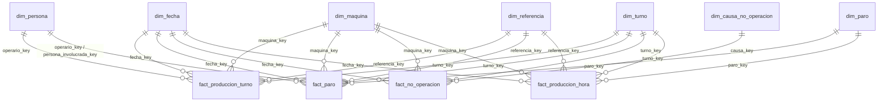

# 3. Modelo dimensional

## 3.1 Elección: constelación de hechos (galaxia) con dimensiones conformadas

**Justificación:**

- **Estrella por proceso, no un solo hecho:** la fuente mezcla tres procesos con granos distintos (producción del turno, eventos de paro, días sin operar). Meterlos en una sola tabla repetiría las horas trabajadas por cada código de paro (doble conteo) — exactamente el problema que tiene hoy el Excel.
- **Constelación y no copo de nieve:** las jerarquías (paro, fecha, referencia) se **aplanan** en cada dimensión. Power BI y Grafana generan menos joins, las consultas son más simples y el volumen de las dimensiones es pequeño (≤ 2.191 filas), así que la redundancia no cuesta.
- **Dimensiones conformadas:** fecha, máquina, turno, referencia y persona son las mismas para los cuatro hechos → se puede comparar el histórico (Excel) con el tiempo real (simulador/PLC) en la misma escala ("drill-across").
- **Llaves subrogadas** en todas las dimensiones, con fila **-1 "Sin registro"** (y -2 "No aplica" en referencia) para no tener FK nulas en los hechos.

## 3.2 Grano de cada tabla de hechos

| Hecho | Grano (una fila = …) | Tipo | Medidas | Filas |
|---|---|---|---|---|
| `dw.fact_produccion_turno` | un **registro de turno** de una máquina: fecha × máquina × turno × operaria × referencia (botón "Ingreso total") | Transaccional | horas trabajadas, planificadas, operativas, de paro (total / programado / no programado), reproceso; pacas, pacas ideales, meta | 5.137 |
| `dw.fact_paro` | un **código (y subcódigo) de paro con minutos > 0** en una fila del formato (resultado de despivotar las 18 parejas) | Transaccional | minutos y horas de paro | 16.482 |
| `dw.fact_no_operacion` | un **registro de horas no trabajadas** de una máquina en un día, con su causa | Transaccional | horas no operadas | 2.147 |
| `ops.fact_produccion_hora` | una **lectura hora a hora** de una máquina (simulador hoy, PLC mañana) | Transaccional (streaming) | minutos disponibles/paro, pacas, rechazos, tasa ideal | continuo |

## 3.3 Dimensiones, atributos y jerarquías

| Dimensión | Atributos principales | Jerarquía | Origen |
|---|---|---|---|
| `dim_fecha` | año, semestre, trimestre, mes, nombre_mes, anio_mes, semana ISO, día, día semana, fin de semana, **festivo Colombia**, día hábil | Año › Semestre › Trimestre › Mes › Día | **Construida** por el ETL (librería `holidays`) |
| `dim_turno` | código, descripción, hora inicio/fin, duración, esquema (3×8, 2×12, 1×10,5), jornada | Esquema › Jornada › Turno | **Construida** (la fuente solo tiene texto libre) |
| `dim_maquina` | código, nombre, línea de producto, planta, factor de velocidad | Planta › Línea › Máquina | Catálogo + hoja *Tiempos* |
| `dim_referencia` (**SCD2**) | marca, presentación cc, n.º colores, unidades/paca, tasa estándar, **tasa ideal**, fuente de la tasa, vigencia | Marca › Presentación › Referencia | Normalización + tabla de estándares |
| `dim_persona` (role-playing) | alias seudónimo (OP-001 / MT-001), rol | Rol › Persona | Seudonimización |
| `dim_paro` | área de impacto, código, nombre, subsistema, componente, es_programado, **categoría OEE** | **Área › Código › Subsistema › Componente** | Catálogo P-MTO-22 + homologación |
| `dim_causa_no_operacion` | texto origen, causa homologada, área responsable, catálogo | Área › Causa homologada › Texto origen | Homologación de 2 catálogos |

### Dimensiones construidas por el equipo
- **`dim_turno`**: no existe como catálogo en la fuente; se modeló con horas, duración, esquema y jornada para analizar el turno nocturno vs diurno.
- **`dim_fecha`** con festivos colombianos (Ley Emiliani) para separar días hábiles.
- **Clasificación OEE en `dim_paro`** (`es_programado`, `categoria_oee`): es una regla de negocio del equipo que no está en el Excel y es la que permite calcular Disponibilidad.

### Cómo se modela la jerarquía de paros
- La jerarquía es **desbalanceada (ragged)**: el código 01 tiene 3 niveles (1.2 › 1.2.D), los códigos 03 y 05 tienen 2 (5.2) y los demás solo 1. Además los datos traen paros registrados a nivel de subsistema sin componente ("1.6 VIDEO JET").
- Se **aplana en una sola dimensión** con una fila por hoja y columnas fijas por nivel; los niveles que no aplican se rellenan con `N/A – No aplica` y los no informados con `S/E – Sin especificar`. Así la jerarquía queda **balanceada** y Power BI hace drill-down Área › Código › Subsistema › Componente sin huecos ni "(en blanco)".
- Alternativas descartadas: **snowflake** (3 tablas encadenadas: más joins y relaciones que Power BI no navega bien) y **tabla puente padre-hijo** (necesaria solo si la profundidad fuera variable e ilimitada; aquí es fija y máxima de 4).

## 3.4 Matriz de bus

| Proceso de negocio ↓ / Dimensión → | Fecha | Máquina | Turno | Referencia | Persona (operaria) | Persona (involucrada) | Paro | Causa no operación |
|---|:-:|:-:|:-:|:-:|:-:|:-:|:-:|:-:|
| Producción por turno (`fact_produccion_turno`) | ✔ | ✔ | ✔ | ✔ | ✔ | | | |
| Paros de producción (`fact_paro`) | ✔ | ✔ | ✔ | ✔ | ✔ | ✔ | ✔ | |
| Días / horas sin operar (`fact_no_operacion`) | ✔ | ✔ | ✔ | | | | | ✔ |
| Monitoreo hora a hora (`ops.fact_produccion_hora`) | ✔ | ✔ | ✔ | ✔ | ✔ | | ✔ | |

## 3.5 SCD (bonificación)

**`dim_referencia` → SCD Tipo 2** sobre la **tasa ideal (meta pacas/hora)**. Cuando ingeniería cambia el estándar de una referencia, el rendimiento de los meses anteriores debe seguir calculándose con la meta que existía entonces; sobrescribir (Tipo 1) "reescribiría la historia" y cambiaría el OEE de periodos ya presentados al comité. Columnas: `valido_desde`, `valido_hasta`, `es_actual`, `version`; índice único parcial para garantizar una sola versión vigente. Implementación: función `dw.fn_scd2_meta_referencia()` (demo en `scripts/demo_scd2.sql`).

Otras decisiones: `dim_maquina.factor_velocidad` → **Tipo 1** (corrección de catálogo); `dim_persona.rol` → **Tipo 1** (el análisis por persona es seudónimo y no histórico).

## 3.6 Diccionario de datos y linaje (resumen)

Convención de origen: **BD** = hoja *Base De Datos*; **TD** = hoja *Tablas Desplegables*; **CAT** = `etl/catalogos/*.csv`; **ETL** = calculado.

### fact_produccion_turno
| Columna | Tipo | Llave | Origen | Regla de transformación |
|---|---|---|---|---|
| registro_id | bigint | PK | BD n.º de fila | Linaje directo a la fila del Excel |
| fecha_key | integer | FK dim_fecha | BD *Fecha* | AAAAMMDD |
| maquina_key | smallint | FK dim_maquina | BD *Maquina* | Lookup catálogo |
| turno_key | smallint | FK dim_turno | BD *Turno* / *Unidad por display* | R07, R08 |
| referencia_key | integer | FK dim_referencia | BD *Referencia* | R09 normalización, SCD2 vigente a la fecha |
| operario_key | integer | FK dim_persona | BD *Operario* | R11, R12 seudonimización |
| horas_trabajadas | numeric(6,2) | | BD *Horas trabajadas* | — |
| horas_paro_total | numeric(8,4) | | BD 18 × *Codigo N* (minutos) | Σ minutos/60 de la fila + filas de subcódigo vinculadas (R17) |
| horas_paro_programado / no_programado | numeric(8,4) | | ETL | Según `dim_paro.es_programado` |
| horas_planificadas | numeric(8,4) | | ETL | máx(0, HT − PP) |
| horas_operativas | numeric(8,4) | | ETL | máx(0, TP − PNP) (R19) |
| horas_reproceso | numeric(8,4) | | BD *Codigo 11* | minutos/60 |
| pacas_producidas_origen | numeric(10,2) | | BD *Pacas producidas* | Sin cambios (reconciliación) |
| pacas_producidas | numeric(10,2) | | BD *Pacas producidas* | NULL si atípica (R22) |
| tasa_ideal_pacas_h | numeric(8,2) | | TD estándares + ETL | máx(estándar, P95) (R18, R24) |
| pacas_ideales / pacas_meta_turno | numeric(10,2) | | ETL | TO × tasa / TP × tasa |
| flag_* | boolean | | ETL | Banderas de calidad |
| observaciones | text | | BD *Observaciones* | Trim |

### fact_paro
| Columna | Tipo | Llave | Origen | Regla |
|---|---|---|---|---|
| paro_evento_id | bigint | PK | ETL | Identity |
| fila_excel | integer | UQ (con paro_key) | BD n.º de fila | Linaje |
| registro_id | bigint | FK fact_produccion_turno (nullable) | ETL | Vinculación de filas de subcódigo (R17) |
| tipo_fila | varchar | | ETL | principal / subcodigo (R03) |
| fecha_key, maquina_key, turno_key, referencia_key, operario_key | | FK | BD | Igual que fact_produccion_turno |
| paro_key | integer | FK dim_paro | BD *Codigo de paro N* + *Sub Codigo* 1/3/5 | Despivote + R13/R14/R15/R16 |
| persona_involucrada_key | integer | FK dim_persona | BD *Personal involucrado* | Solo código 05; seudonimizado |
| area_involucrada | varchar | Degenerada | BD *Área involucrada en subcodigo 5* | Solo código 05 |
| minutos_paro / horas_paro | numeric | | BD *Codigo de paro N* | Solo minutos > 0 |

### fact_no_operacion
| Columna | Tipo | Llave | Origen | Regla |
|---|---|---|---|---|
| no_operacion_id | bigint | PK | BD n.º de fila | — |
| fecha_key, maquina_key, turno_key | | FK | BD | Turno -1 si la fila no es de turno |
| causa_key | integer | FK dim_causa_no_operacion | BD *Tipo de paro* | Homologación R23 |
| horas_no_operadas | numeric(6,2) | | BD *Horas no trabajadas* | Solo > 0 |
| observacion_paro | varchar(120) | | BD *Observaciones de paro* | Trim |

### Dimensiones
| Tabla | PK | Llave natural | Origen |
|---|---|---|---|
| dim_fecha | fecha_key (AAAAMMDD) | fecha | ETL (calendario 2022-2027 + festivos) |
| dim_turno | turno_key | turno_codigo | CAT `turnos.csv` |
| dim_maquina | maquina_key | maquina_codigo | CAT `maquinas.csv` + hoja *Tiempos* |
| dim_referencia | referencia_key (identity) | referencia_nk + valido_desde | BD *Referencia* + TD estándares + CAT correcciones |
| dim_persona | persona_key | alias | BD *Operario* / *Personal involucrado* (seudonimizado) |
| dim_paro | paro_key | codigo_paro + subsistema + componente | CAT `paro_codigos.csv`, `subcodigos.csv` (de TD y TABLA CODIGOS) |
| dim_causa_no_operacion | causa_key | texto_origen | CAT `tipo_paro_homologacion.csv` |

## 3.7 Restricciones e índices
- **PK/FK** en todos los hechos (integridad referencial garantizada por el motor, no por el ETL).
- **CHECK**: horas ≥ 0, minutos > 0, pacas ≥ 0, rechazos ≤ producidas, paros ≤ minutos disponibles, vigencia SCD válida, modos del simulador.
- **UNIQUE**: `(fila_excel, paro_key)` en fact_paro evita duplicar un evento; índice único parcial en la versión vigente de cada referencia.
- **Índices** (`05_indices_auditoria.sql`): compuesto `(maquina_key, fecha_key)` en cada hecho (filtro típico máquina + periodo), `fact_paro(paro_key) INCLUDE (horas_paro)` para Pareto con *index-only scan*, FK indexadas para los joins estrella; en tiempo real **BRIN(ts)** (datos que llegan ordenados en el tiempo, índice diminuto) y `(maquina_key, ts DESC)` para "última lectura por máquina".
